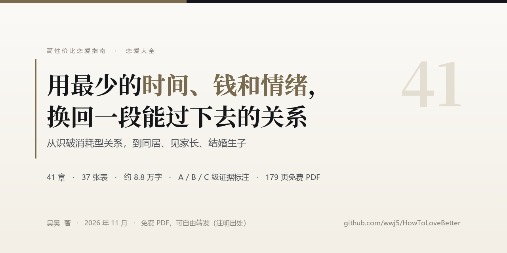
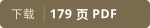
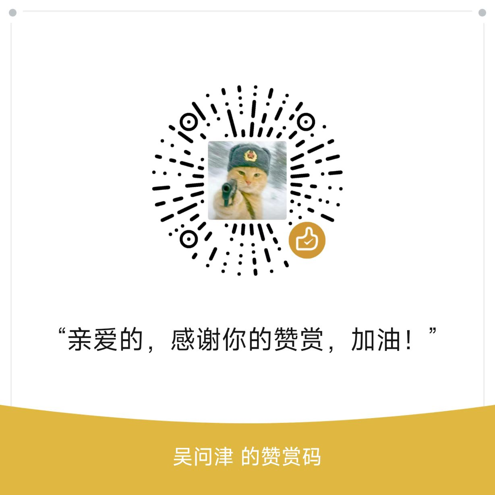

  

<h3 align="center">HowToLoveBetter　·　高性价比恋爱指南</h3>

用最少的时间、钱和情绪，换回一段能过下去的关系

  
  
  
  
  

---

## 这本书讲什么

把《高性价比人生指南》的做法搬到恋爱这件事上：每一件事拆成「花掉什么、换回什么、证据有多硬」。能给出数字的地方给数字，给不出数字的地方明写「这是经验」，并标成 C 级。

全书用三个判据做决定：**净收益、可改变性、退出成本**。所有的「要不要继续」「要不要分手」「要不要结婚生子」，都还原成这三项打分。

它不承诺把人变完美，也不教你跟别人比。评价标准只有一个：你在这段关系里，比单身时更好还是更差。

## 这本书不教你什么

- **不追求完美。** 等「准备好了」的时刻不会来；择偶标准不超过五条，且必须是「不能忍」而不是「最好有」。
- **不教你攀比。** 别人的恋爱是剪辑过的，你拿高光片段比自己的日常，怎么比都输。
- **技巧不能替代真诚。** 套路能让人被喜欢一阵子，真诚才能让人被爱很久。

## 全书结构（41 章）

| 篇 | 篇名 | 章次 | 解决什么 |
|---|---|---|---|
| 一 | 认识 | 1–6 | 能遇到谁、前 72 小时、网恋怎么核、第一次见面、定关系、异地 |
| 二 | 止损 | 7–14 | 三判据、六种消耗型关系、红旗绿旗、四条红线、沉没成本、分手执行、三十题自查 |
| 三 | 理论底座 | 15 | 一条读法路线（其余书评见附录 E-1） |
| 四 | 技巧拆解 | 16–17 | 三条筛子、一份动作清单（十本书点评见附录 E-2） |
| 五 | 证据 | 18–24 | 吸引力、关系质量、冲突、依恋、同居与结婚、分手恢复、怎么读论文 |
| 六 | 宝典 | 25–26 | 一页书单、九十天行动方案 |
| 七 | 过日子 | 27–33 | 恋爱期的钱、同居、日常维护、见家长、吵架修复、中期检查、钱合并 |
| 八 | 算账 | 34–41 | 结婚七笔账、领证婚检、彩礼与债务、生孩子、能领的钱、孕产清单、出生后手续 |

附录：

- **附录 A–D**（工具与出处）：术语表、来源清单、按问题速查、引用格式
- **附录 E**（书单与点评）：E-1 十二本理论书、E-2 十本技巧书逐本点评、E-3 按处境分类书单

## 数字从哪来

- 母本：GitHub `eternity4719/HowToLiveBetter`（第 8、10、18、27 节），CC-BY-4.0 与 MIT 双许可
- 官方统计：国家统计局《2018 年全国时间利用调查公报》、2023 年居民收入数据；民政部《2024 年民政事业发展统计公报》；《中国人口普查年鉴-2020》
- 学术研究：Gottman 与 Levenson 的追踪研究、Robles 等（2006）回应行为综述、Aron 的 36 问实验、CFPS 同居数据、Baxter 的分手研究等
- 机构调查：中国人民大学人口与发展研究中心 2023 年结婚花费专项调查
- 书单：IndexRead「亲密关系必读书单 Top 15」（2026 年 7 月更新，含联盟推广链接，已在附录标注）

每章末尾的「注」都标明该章引用的出处与证据等级。能查到原文的都留了可检索信息，方便你自己复核。

## 版本与文件

- 版本：2026 年 11 月 · 内部版
- 在线阅读：`read.html`，41 章全文，带侧边目录、章节锚点、可调字号
- PDF 预览：`pdf.html`，站内直接翻页看，不用先下载
- PDF：`高性价比恋爱指南.pdf`，A4，179 页，含带页码目录

## 赞赏

这本书免费到底：179 页，没有付费墙，也不打算再出一个收费的第二版。

如果它帮你少走了半年弯路，或者替你把一次没想明白的分手捋顺了，可以扫这张码，请我喝杯咖啡。金额随意，一块两块都行。赞赏完全自愿，跟能不能下载没关系——不给钱也一样能读、能转、能打印。

  

## 广告位

首页留了一个位置，只放我读过、觉得对读者有用的东西：朋友写的书、顺手的工具、值得看的一门课。不做竞价排名，也不挂返利链接。想放，[在仓库里开个 issue](https://github.com/wwj5/HowToLoveBetter/issues/new) 就行。

## 许可与转发

沿用母本的双许可：**正文 CC-BY-4.0，代码与模板 MIT**。

允许整本或片段自由转发、打印、分享，条件是：

1. 保留书名、作者署名与版本日期；
2. 保留文中「注」与「案例来源」的出处标注；
3. 不删改证据等级标记。

商业用途需事先授权。详细条款见 `许可与转发条款.md`。

## 说明

本书是个人写作，不是专业意见。涉及法律、医疗、财务的具体事项，以当地主管部门、律师与医生的说法为准。书中数据均为公开来源，标注了年份；政策类内容请以当期官方发布为准。
